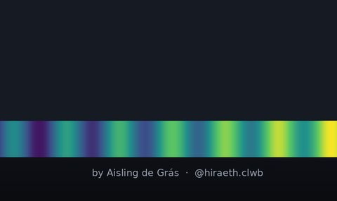
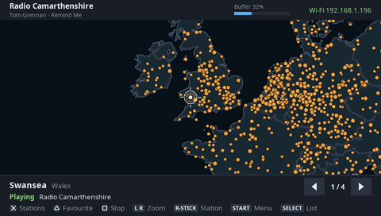

# PS Vita Homebrew

Homebrew for the PlayStation Vita from Hiraeth Systems. Each project lives in its own repository; this page is the catalogue.

Everything here runs on a Vita with HENkaku or ensō, and has been tested on a PCH-1000.

## Apps

| Preview | Project | Latest download | Status |
|---|---|---|---|
|  | **[VitaSDR](https://github.com/hiraethsystems/VitaSDR)** A client for web SDR receivers. Connect to a KiwiSDR or OpenWebRX receiver anywhere in the world and get live audio, tuning and an RF waterfall: a shortwave radio in your hands, using someone else's antenna. | **[VPK](https://github.com/hiraethsystems/VitaSDR/releases/latest)** | v0.3.0, working on hardware |
|  | **[DX Garden](https://github.com/hiraethsystems/DX-Garden)** An internet radio player and explorer. Spin a globe, stop the crosshair on a place and hear what's on air there, or browse by country, city or genre. Comes with about 7,500 stations from Radio Browser, and the list is yours to edit. | **[VPK](https://github.com/hiraethsystems/DX-Garden/releases/latest)** | v0.9.0 beta |

## Games

| Preview | Project | Latest download | Status |
|---|---|---|---|
|  | **[Moon Child FE for Vita](https://github.com/hiraethsystems/MoonChildVita)** A Vita port of Moon Child FE, the modern source port of Team Hoi's 1997 Windows 95 platformer Moon Child. | Not yet released | In development |

## Installing

1. Download the `.vpk` from the project's release page.
2. Copy it to your Vita.
3. Install it with VitaShell.

To update, install the new VPK over the old one. Each project's own README has the details, including where it keeps its settings.

## Licences

Each project has its own licence and credits. See its repository for details.
